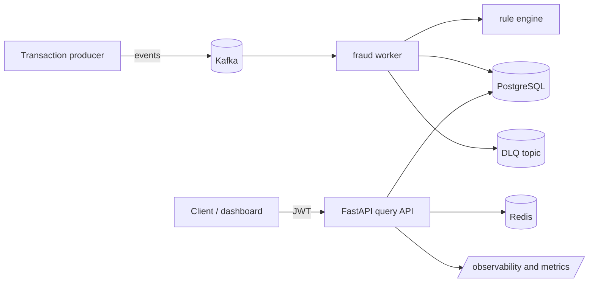

# Fraud Detection

Fraud Detection is a Python-based event-processing service that evaluates transaction events, applies explainable fraud rules, and exposes a JWT-protected query API for fraud decisions and transaction history.

## What this project does

- Ingests transaction events from Kafka and scores them against deterministic fraud rules.
- Persists the latest decision and the full decision history in PostgreSQL.
- Uses Redis and a rate-limited API layer for operational guards and fast lookups.
- Exposes a FastAPI-based read API protected by Keycloak-issued JWT tokens.
- Ships with Docker Compose for local development and a Helm chart for Kubernetes deployment.

## Architecture



## Repository layout

- [app/](app) — application runtime and API modules.
- [tests/](tests) — pytest suite for validation.
- [infra/](infra) — deployment runbook and Helm deployment notes.
- [fraud-detection/](fraud-detection) — Helm chart for the service stack.
- [rules.json](rules.json) — default rule definitions used by the worker.
- [docker-compose.yml](docker-compose.yml) — local runtime with Postgres, Redis, Kafka, the API, and worker services.
- [requirements.txt](requirements.txt) — Python dependencies.
- [integration_test.py](integration_test.py) — end-to-end smoke test for Kafka to API validation.

## Quick start

1. Create the local environment file from the sample:

```bash
cp .env.example .env
```

2. Create a Python virtual environment and install dependencies:

```bash
python -m venv .venv
source .venv/bin/activate
python -m pip install --upgrade pip
python -m pip install -r requirements.txt
```

3. Start the local stack:

```bash
docker compose --env-file .env up --build
```

4. Verify the API is healthy:

```bash
curl http://localhost:8000/health
```

Common local service endpoints:

- API: http://localhost:8000
- PostgreSQL: localhost:5432
- Redis: localhost:6379
- Kafka broker: localhost:9092
- Worker metrics: http://localhost:9100/metrics

A Keycloak bootstrap job is included as part of the local stack, but the identity provider itself is not exposed as a standalone local browser endpoint in this compose configuration.

## API surface

Health and readiness endpoints:

- GET /live
- GET /ready
- GET /health

Protected transaction read endpoints:

- GET /api/v1/transactions/{transaction_id}
- GET /api/v1/categories/{category_name}
- GET /api/v1/user/{user_id}

Rule evaluation endpoint:

- POST /api/v1/rules/{rule_key}/evaluate

The API expects a valid JWT token with the required scope, usually `fraud:transactions:read`.

## Fraud rules

Rules are defined in [rules.json](rules.json). The default configuration includes rule families such as:

- HIGH_VALUE_THRESHOLD
- RISKY_CATEGORY_LIMIT
- VELOCITY_COUNT_EXCEEDED
- VELOCITY_AMOUNT

The worker reads the rules file at runtime and applies them to event payloads. When the file changes, the worker can reload the configuration during operation.

## Local validation and smoke tests

Run the project test suite:

```bash
pytest tests -q --disable-warnings
```

Run with coverage:

```bash
pytest tests -q --disable-warnings --cov=app --cov-report=term-missing
```

Run the end-to-end smoke test:

```bash
python integration_test.py
```

## Operational notes

- Structured logs are emitted to stdout and designed for central collection in a hosted platform.
- Failed worker processing is redirected to a DLQ topic instead of silently dropping data.
- The app includes readiness checks, request rate limiting, and tracing/logging hooks.
- The production deployment path uses the Helm chart in [fraud-detection/](fraud-detection).

## Troubleshooting

If the stack does not come up cleanly, reset the local Compose state and rebuild:

```bash
docker compose --env-file .env down -v --remove-orphans
docker compose --env-file .env up --build
```

If the auth helper endpoints fail, confirm Keycloak has initialized and your demo users are present before retrying the token flow.

## Related documentation

- [app/README.md](app/README.md) — package-level module overview.
- [infra/README.md](infra/README.md) — Helm and Kubernetes deployment runbook.
- [fraud-detection/README.md](fraud-detection/README.md) — chart-specific deployment summary.
