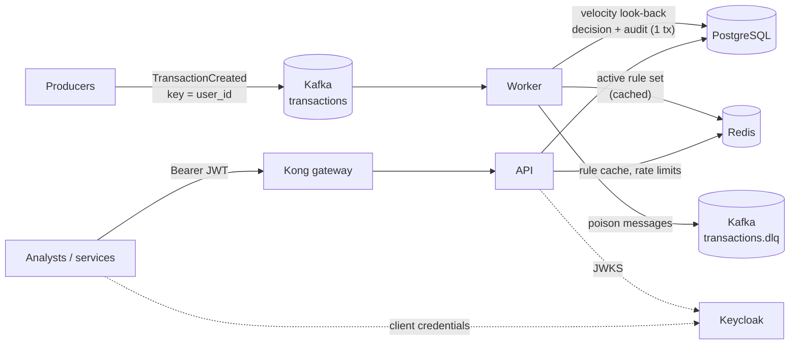

# Fraud Detection

A service that consumes categorised transaction events from Kafka, scores each one
against a versioned set of fraud rules, stores the decision in PostgreSQL, and serves
decisions and rule sets over an authenticated HTTP API.

- **Worker**: Kafka consumer that turns `TransactionCreated` events into fraud decisions.
- **API**: FastAPI service to read decisions and to publish, inspect and dry-run rule sets.
- **Batch job**: daily fraud-activity summary.

Everything runs from one Docker image; Docker Compose starts the full stack locally
and the Helm chart in [fraud-detection/](fraud-detection) deploys it to Kubernetes.

## Contents

- [Requirements coverage](#requirements-coverage)
- [Architecture](#architecture)
- [Quick start](#quick-start) - build, run, try it, test
- [API](#api)
- [Event contract](#event-contract)
- [Rules, scores and verdicts](#rules-scores-and-verdicts)
- [Design decisions and trade-offs](#design-decisions-and-trade-offs)
- [Operations](#operations)
- [Configuration](#configuration)
- [Assumptions and scope](#assumptions-and-scope)

## Requirements coverage

| Requirement (from the brief) | Where | Verified by |
|---|---|---|
| Process categorised transaction events | [app/events.py](app/events.py) (contract), [app/worker.py](app/worker.py) (consumer) | [tests/unit/test_events.py](tests/unit/test_events.py), [tests/integration/test_pipeline.py](tests/integration/test_pipeline.py) |
| Apply a set of fraud rules per transaction, based on different criteria | [app/rules.py](app/rules.py), [app/processing.py](app/processing.py) - amount, category, per-user velocity (count and value), currency | [tests/unit/test_rules.py](tests/unit/test_rules.py) (every threshold at, below and above its boundary) |
| Store the results in a data store | [app/database.py](app/database.py), [alembic/versions/](alembic/versions) | [tests/integration/test_repository.py](tests/integration/test_repository.py) |
| Allow retrieval via an API | [app/api.py](app/api.py) | [tests/unit/test_api.py](tests/unit/test_api.py), [tests/integration/test_pipeline.py](tests/integration/test_pipeline.py), [scripts/smoke_test.py](scripts/smoke_test.py) |
| Production grade | Sections below: idempotency, retries and DLQ, auth, observability, migrations, hardened containers, CI | 220+ tests, CI gates in [.github/workflows/ci.yml](.github/workflows/ci.yml) |
| Runnable Dockerfile | [Dockerfile](Dockerfile) | CI `image` job builds it, checks it runs as non-root, scans it |
| README explaining build, run and test | This file | - |

## Architecture



How one message is processed ([app/processing.py](app/processing.py)):

1. Parse and validate the event against the v1 contract (bad input is dead-lettered, never retried).
2. Load the active rule set: in-process copy (5 s), then Redis (60 s), then PostgreSQL.
3. Query the user's other transactions with `occurred_at` in `[occurred_at - window, occurred_at]` (count, and sum in the same currency).
4. Evaluate every rule; sum the scores of those that fire; map the total to a verdict.
5. In **one database transaction**, insert the decision (first write wins) and an audit row keyed by the Kafka offset.
6. Store the offset; librdkafka commits it. A crash before this point redelivers the message, which step 5 makes harmless.

| Component | Responsibility | Key files |
|---|---|---|
| Worker | Per-partition ordered processing, retries, DLQ, backpressure, graceful rebalance and shutdown | [app/worker.py](app/worker.py), [app/dlq.py](app/dlq.py), [app/kafka_config.py](app/kafka_config.py) |
| Rules engine | Safe JsonLogic subset, validation at write time, scoring | [app/rules.py](app/rules.py) |
| Persistence | Schema, idempotent writes, keyset pagination, rule-set versions | [app/database.py](app/database.py), [alembic/](alembic) |
| API | Decisions, rule-set management, health, uniform errors | [app/api.py](app/api.py), [app/schemas.py](app/schemas.py) |
| Security | JWT verification, scopes, per-caller rate limit | [app/security.py](app/security.py), [app/rate_limit.py](app/rate_limit.py) |
| Observability | JSON logs with correlation IDs, Prometheus metrics, OpenTelemetry | [app/observability.py](app/observability.py) |

## Quick start

Prerequisites: Docker with Compose v2 (give it at least 4 CPUs and 6 GB of memory;
Keycloak and Kafka are the heavy parts), and Python 3.14 to run the tests and scripts.

### Build and run

```bash
cp .env.example .env          # local-only credentials; change them for anything shared
docker compose up --build --wait
```

`--wait` returns once every service is healthy: PostgreSQL, Redis, Kafka, Keycloak,
the one-shot `migrate` and `kafka-init` jobs, the API and the worker.

| What | Where |
|---|---|
| API (OpenAPI docs at `/docs`) | http://localhost:8000 |
| Keycloak (admin console) | http://localhost:8080 |
| Worker metrics | http://localhost:9100/metrics |
| Kafka for host-side scripts | localhost:29092 |

Build the image on its own with `docker build -t fraud-detection .`. The same image
runs every process; the command selects which (`uvicorn app.main:app`,
`python -m app.worker`, `python -m app.batch_worker`, `alembic upgrade head`).

### Try it

```bash
python -m venv .venv && . .venv/bin/activate        # Windows: .venv\Scripts\activate
pip install --require-hashes -r requirements.lock -r requirements-dev.lock

# 1. Get a token (client credentials; secrets are in .env)
TOKEN=$(curl -s http://localhost:8080/realms/fraud/protocol/openid-connect/token \
  -d grant_type=client_credentials -d client_id=fraud-analyst \
  -d client_secret=local-dev-analyst-secret | python -c 'import json,sys; print(json.load(sys.stdin)["access_token"])')

# 2. Publish a high-value crypto purchase
python scripts/publish_event.py --amount 14500.00 --category CRYPTO
#  -> prints the event, including its transaction_id

# 3. Read the decision
curl -s -H "Authorization: Bearer $TOKEN" http://localhost:8000/api/v1/transactions/<transaction_id>
```

Or run every documented scenario end to end (rules at their boundaries, velocity,
duplicates, the DLQ, a rule-set change picked up by the worker, auth failures):

```bash
python scripts/smoke_test.py      # exits non-zero if any scenario fails
```

### Test

```bash
pytest                                     # unit + integration (integration needs Docker)
pytest tests/unit                          # unit tests only, no Docker needed
pytest --cov=app                           # with coverage; the gate is 85%
ruff check . && ruff format --check .      # lint and formatting, as CI runs them
```

Integration tests start throwaway PostgreSQL, Redis and Kafka containers
([tests/integration/conftest.py](tests/integration/conftest.py)), build the schema with
`alembic upgrade head`, and drive the real worker and API against them.

| Suite | Covers |
|---|---|
| `tests/unit` | Rules at every boundary, scoring bands, event validation, error classification, retry/DLQ policy, ordered offset storage, backpressure, rule cache layers, JWT checks (expired, wrong audience/issuer, algorithm confusion, JWKS refresh throttling), rate limiting, every API error shape, settings fail-fast |
| `tests/integration` | Migrations, idempotent writes under redelivery and re-publication, conflicting duplicates, the velocity window's bounds, keyset pagination, index use, concurrent rule-set writes, Kafka -> worker -> PostgreSQL -> API end to end, DLQ, restart without reprocessing |
| `scripts/smoke_test.py` | The running Compose stack, through Keycloak, Kafka and the gateway-free API |

## API

All endpoints except `/live`, `/ready` and `/metrics` need `Authorization: Bearer <JWT>`
with the listed scope. Full schema: http://localhost:8000/docs.

| Method and path | Scope | Purpose |
|---|---|---|
| `GET /api/v1/transactions/{transaction_id}` | `fraud:transactions:read` | One decision |
| `GET /api/v1/transactions` | `fraud:transactions:read` | Newest first; filters `user_id`, `category`, `verdict`, `is_fraud`, `occurred_from`, `occurred_to`; `limit` (1-100) and `cursor` |
| `GET /api/v1/rule-sets/{key}/active` | `fraud:rules:read` | The version currently applied |
| `GET /api/v1/rule-sets/{key}/versions` | `fraud:rules:read` | Version history, newest first |
| `GET /api/v1/rule-sets/{key}/versions/{n}` | `fraud:rules:read` | One version |
| `POST /api/v1/rule-sets/{key}/versions` | `fraud:rules:write` | Publish a new version (active immediately) |
| `POST /api/v1/rule-sets/{key}/evaluate` | `fraud:rules:read` | Dry-run a hypothetical transaction; stores nothing |
| `GET /live`, `GET /ready` | - | Liveness (process) and readiness (PostgreSQL and Redis) |

The Keycloak realm ([fraud-detection/files/fraud-realm.json](fraud-detection/files/fraud-realm.json))
defines two clients: `fraud-analyst` (read scopes) and `fraud-rules-admin` (adds `fraud:rules:write`).

A decision:

```json
{
  "transaction_id": "0192f3c4-6b1e-7c2a-9d3f-5e8a1b2c3d4e",
  "user_id": "0192f3c4-6b1e-7c2a-9d3f-000000000042",
  "amount": "14500.00",
  "currency": "ZAR",
  "category": "CRYPTO",
  "occurred_at": "2026-10-29T19:04:15Z",
  "channel": "ONLINE",
  "country": "ZA",
  "enrichment": {"distance_from_last_tx_km": "5.2"},
  "risk_score": 90,
  "verdict": "REJECTED",
  "is_fraud": true,
  "triggered_rules": ["HIGH_VALUE_THRESHOLD", "RISKY_CATEGORY_LIMIT"],
  "rules_version": "fraud-default@v1",
  "rules_hash": "4f0c...e9",
  "correlation_id": "cli-6a2f...",
  "created_at": "2026-10-29T19:04:16.120Z"
}
```

Paging: pass the response's `next_cursor` as `cursor`; it is `null` on the last page.

```bash
curl -s -H "Authorization: Bearer $TOKEN" \
  "http://localhost:8000/api/v1/transactions?verdict=REJECTED&limit=20"
```

Publishing a rule-set version (with an optimistic-concurrency guard):

```bash
curl -s -X POST http://localhost:8000/api/v1/rule-sets/fraud-default/versions \
  -H "Authorization: Bearer $ADMIN_TOKEN" -H "Content-Type: application/json" \
  -d '{"description": "Lower high-value threshold", "expected_current_version": 1,
       "definition": { ...full rule set, see below... }}'
# 201 + Location header; 409 if someone else published version 2 first; 422 with field details if invalid
```

Every error has the same shape, and `correlation_id` matches the `X-Correlation-ID`
response header and the server's logs:

```json
{"error": {"code": "validation_error", "message": "Request validation failed.",
           "details": [{"field": "query.limit", "message": "Input should be less than or equal to 100"}],
           "correlation_id": "6c98ba7c-64fe-4b82-ab16-d29a9b15b3a2"}}
```

Codes: `bad_request` 400, `unauthorized` 401, `forbidden` 403, `not_found` 404,
`conflict` 409, `validation_error` 422, `rate_limited` 429 (with `Retry-After`),
`internal_error` 500 (never includes internals), `service_unavailable` 503 (with `Retry-After`).

## Event contract

Topic `transactions`, **message key = `user_id`** (so a user's events are ordered on one partition):

```json
{
  "schema_version": 1,
  "event_type": "TransactionCreated",
  "transaction_id": "0192f3c4-6b1e-7c2a-9d3f-5e8a1b2c3d4e",
  "user_id": "0192f3c4-6b1e-7c2a-9d3f-000000000042",
  "amount": "14500.00",
  "currency": "ZAR",
  "category": "CRYPTO",
  "occurred_at": "2026-10-29T19:04:15Z",
  "channel": "ONLINE",
  "country": "ZA",
  "correlation_id": "upstream-trace-id",
  "enrichment": {
    "distance_from_last_tx_km": "5.2",
    "minutes_since_last_tx": 45,
    "user_historical_avg_spend": "1200.00",
    "is_new_merchant_for_user": true,
    "is_travel_itinerary_active": false
  }
}
```

| Field | Rules |
|---|---|
| `transaction_id`, `user_id` | UUIDs. `transaction_id` is the idempotency key |
| `amount` | > 0, at most 2 decimal places; a decimal string or JSON number (parsed exactly, never as a float) |
| `currency` | ISO 4217, e.g. `ZAR` |
| `category` | 1-64 of `A-Z 0-9 _ -`, case-insensitive (stored upper case); merchant category codes such as `7995` fit |
| `occurred_at` | ISO-8601 **with** a timezone; this is the time velocity windows are measured in |
| `channel`, `country`, `correlation_id`, `enrichment` | Optional. `enrichment` carries features computed upstream; the service does not depend on them |

**Versioning.** Unknown fields are ignored, so producers can add optional fields at any
time. Renaming, removing or redefining a field needs a new `schema_version`; this
consumer dead-letters versions it does not know rather than guessing.

## Rules, scores and verdicts

A rule set is versioned data, not code: publishing a new version changes behaviour
without a deploy, and every decision records the version (`rules_version`) and the
SHA-256 of its definition (`rules_hash`) that produced it. The default rule set,
seeded by the migration:

| Rule | Fires when | Score |
|---|---|---|
| `HIGH_VALUE_THRESHOLD` | amount >= R10,000.00 | 40 |
| `RISKY_CATEGORY_LIMIT` | category is `GAMBLING` or `CRYPTO` and amount > R5,000.00 | 50 |
| `VELOCITY_COUNT_EXCEEDED` | more than 5 transactions by the user within 60 s (this one included) | 40 |
| `VELOCITY_AMOUNT` | more than R50,000.00 by the user within 60 s, same currency (this one included) | 50 |
| `FOREIGN_CURRENCY` | currency is not ZAR, so the ZAR thresholds above do not apply | 30 |

| Total score | Verdict | Meaning |
|---|---|---|
| 0-29 | `APPROVED` | No action |
| 30-74 | `REVIEW` | One strong signal: queue for an analyst |
| 75+ | `REJECTED` | Two signals together: restrict and investigate |

`is_fraud` is `true` for `REVIEW` and `REJECTED`. Scoring happens **after**
authorisation (it consumes events), so `REJECTED` is a recommendation to act on the
account, not a declined payment.

Rule conditions are [JsonLogic](https://jsonlogic.com) evaluated by a small local
interpreter ([app/rules.py](app/rules.py)) with these variables: `amount`, `currency`,
`category`, `velocity.prior_count`, `velocity.prior_amount`, and the optional
`channel`, `country`, `enrichment.*`. A rule that reads an optional variable must give
a default (`{"var": ["enrichment.distance_from_last_tx_km", 0]}`), or events without
it would fail. Publishing validates operators, arity, variable names, size and depth,
then dry-runs the set, so a broken rule is rejected with a 422 instead of failing
every live transaction.

## Design decisions and trade-offs

Each decision names the failure it prevents and what it costs.

**At-least-once delivery, idempotent writes.** Offsets are stored only after the
decision is committed, so a crash between commit and offset storage redelivers the
message. Without a guard, the redelivery would insert a second decision, or a primary-key
conflict would be retried forever. Instead the decision insert is `ON CONFLICT DO NOTHING`
on `transaction_id` and the audit row is unique on `(topic, partition, offset)`: the
redelivery becomes a no-op, and a re-*published* event is recorded as `duplicate`.
*Cost:* one extra read on duplicates.

**First decision wins.** A duplicate event is not re-scored, because its velocity context has
changed since (the original now counts as a prior transaction), so re-scoring would
silently change a decision analysts may already have acted on. A duplicate id with
*different* data is a producer bug: it is rejected (`ConflictingDuplicateError`) and
dead-lettered, and nothing is written.

**Ordered processing per partition.** Two events for the same user processed
concurrently would each miss the other in the velocity look-back and under-count.
Keying by `user_id` plus one in-order task per partition prevents that; partitions
still run in parallel. Offsets are stored in order per partition, so an offset is
never committed ahead of an unfinished message (which would lose it on a crash).
*Cost:* a slow message delays the rest of its partition; scaling is bounded by the
partition count (the chart refuses an HPA maximum above it).

**Event-time velocity windows.** The window is `[occurred_at - 60 s, occurred_at]`,
not "the last 60 s of processing", so consumer lag and replays give the same answer.
*Known gap:* an event that arrives late is scored with the earlier events it can see,
but events already scored are not re-scored to include it.

**Three failure classes** ([app/errors.py](app/errors.py)):

| Class | Examples | Worker response |
|---|---|---|
| transient | PostgreSQL/Redis down, pool timeout, no rule set yet | retry with capped exponential backoff and jitter, indefinitely, holding the partition |
| permanent | invalid event, unknown schema version, conflicting duplicate | dead-letter immediately |
| unexpected | anything else (likely a bug triggered by that message) | retry 3 times, then dead-letter |

Dead-lettering on transient errors would empty all good traffic into the DLQ during a
database outage; retrying permanent errors would block a partition forever. The DLQ
keeps the original bytes and records the reason in headers, so
[scripts/replay_dlq.py](scripts/replay_dlq.py) replays exactly what was received.

**Backpressure without losing group membership.** A partition whose backlog reaches
500 is paused and resumed at 250, so polling never blocks. A blocked poll loop
exceeds `max.poll.interval.ms`, which gets the consumer evicted and triggers a
rebalance storm.

**Rule sets as versioned data behind a cache.** The worker keeps the active version
for 5 s, Redis for 60 s, PostgreSQL is the source of truth. Publishing overwrites the
Redis entry, so workers switch within ~5 s. *Trade-off:* if that Redis write fails,
workers can lag by up to 65 s. If PostgreSQL is down, workers keep the last version
they loaded rather than stopping.

**Exact money.** `numeric(18,2)` in PostgreSQL, `Decimal` end to end, JSON numbers
parsed as decimals, rule arithmetic in `Decimal`. With floats, `49999.99 + 0.01` is
not reliably equal to `50000`, which makes threshold boundaries unreliable.

**PostgreSQL rather than a key-value store.** Besides lookups by id, the service needs
per-user time-range aggregation (velocity), filtered and paginated listing, and an
atomic decision-plus-audit write. All of these come from indexes and one transaction. Keyset
pagination keeps every page an index range scan.

**Fail fast on configuration.** Missing or invalid settings stop the process at
startup with the variable names (never the values). No credential has a default in
code; secrets come from the environment or `<NAME>_FILE` mounts.

## Operations

**Logs** are one JSON object per line on stdout: `timestamp`, `level`, `service`,
`event`, `correlation_id` (from the event, or the `X-Correlation-ID` request header)
and context. Keys such as `authorization`, `password` and `token` are redacted at any
depth. Transaction amounts and user ids are not logged.

**Metrics** (`/metrics` on the API, `:9100/metrics` on the worker):

| Metric | Use |
|---|---|
| `fraud_worker_messages_total{status}` | `evaluated` / `duplicate` / `dlq` throughput |
| `fraud_worker_decisions_total{verdict}`, `fraud_worker_rule_triggers_total{rule}` | Verdict mix and which rules fire |
| `fraud_worker_retries_total{failure_class}` | Dependency trouble |
| `fraud_worker_partition_backlog{partition}` | Falling behind |
| `fraud_worker_message_duration_seconds` | Scoring latency |
| `fraud_http_requests_total`, `fraud_http_request_duration_seconds` | API traffic by route template (never raw paths) |
| `fraud_database_up`, `fraud_kafka_up`, `fraud_rate_limiter_errors_total`, `fraud_rule_cache_lookups_total{layer}` | Dependency health |

Alert rules for these ship with the chart ([fraud-detection/templates/alerting.yaml](fraud-detection/templates/alerting.yaml)).

**Dead letters**: `python scripts/replay_dlq.py --dry-run` lists them with the failure
reason. Fix the cause, then run without `--dry-run`.

**Changing rules**: publish a version with `POST /api/v1/rule-sets/{key}/versions`.
Try it first with `/evaluate`. Roll back by publishing the previous definition as a
new version (versions are append-only, so history is never lost).

**Health**: the API's `/live` checks only the process (a database outage must not
restart every pod); `/ready` checks PostgreSQL and Redis. The worker writes a
heartbeat file from its poll loop (checked by `python -m app.healthcheck worker`) and
exits for a restart if it has been outside its consumer group for 2 minutes.

**Kubernetes**: see [infra/README.md](infra/README.md).

## Configuration

All settings are environment variables ([app/settings.py](app/settings.py)); any of them
can instead be read from a file named by `<NAME>_FILE`.

| Variable | Required | Default | Purpose |
|---|---|---|---|
| `DATABASE_URL` | yes | - | PostgreSQL URL |
| `REDIS_URL` | yes | - | Redis URL (rule cache, rate limits) |
| `KAFKA_BOOTSTRAP_SERVERS`, `KAFKA_TOPIC_NAME`, `KAFKA_CONSUMER_GROUP_ID` | yes | - | Kafka |
| `KAFKA_DLQ_TOPIC_NAME` | no | `<topic>.dlq` | Dead-letter topic |
| `KAFKA_SECURITY_PROTOCOL` | no | `PLAINTEXT` | `SSL` or `SASL_SSL` (+ `KAFKA_SSL_*`, `KAFKA_OAUTH_*`) outside local dev |
| `JWT_ISSUER`, `JWT_AUDIENCE` | yes | - | Expected `iss` and `aud` |
| `JWT_JWKS_URL` or `JWT_PUBLIC_KEY_PATH` | one | - | Signing keys |
| `JWT_ALGORITHMS` | no | `RS256` | Asymmetric algorithms only |
| `RULE_SET_KEY` | no | `fraud-default` | Rule set the worker applies |
| `RATE_LIMIT_REQUESTS`, `RATE_LIMIT_WINDOW_SECONDS` | no | 100 / 60 | Per caller |
| `CORS_ALLOWED_ORIGINS` | no | empty (none) | Comma-separated |
| `WORKER_PARTITION_HIGH_WATERMARK` | no | 500 | Backlog that pauses a partition |
| `WORKER_MAX_UNEXPECTED_ERROR_ATTEMPTS` | no | 3 | Before dead-lettering |
| `OBSERVABILITY_LOG_LEVEL`, `OBSERVABILITY_ENABLE_TRACING`, `OTEL_EXPORTER_OTLP_ENDPOINT` | no | `INFO` / off | Logging and tracing |

## Assumptions and scope

The brief does not specify these, so they were decided and are easy to change:

- **Thresholds are in ZAR**, and non-ZAR transactions go to `REVIEW` rather than being converted; FX conversion is out of scope.
- **"User"** is the subject of velocity rules. If velocity should be per account or per card, key events by that id instead.
- **The API is for back-office callers** (analysts and services), so access is granted per scope rather than per record owner; there is no end-customer access.
- **Scoring is asynchronous**, after authorisation. Blocking a payment in real time would need a synchronous path in the authorisation flow, with its own latency and availability guarantees; it is not part of this service.
- **Scores and bands are starting values.** Without labelled fraud data they cannot be calibrated; publish new versions as outcomes are learned.
- **Upstream enrichment features are optional inputs.** The service computes its own velocity aggregates, which keeps it correct without a feature platform.

Security details: [SECURITY.md](SECURITY.md). Module map: [app/README.md](app/README.md).
