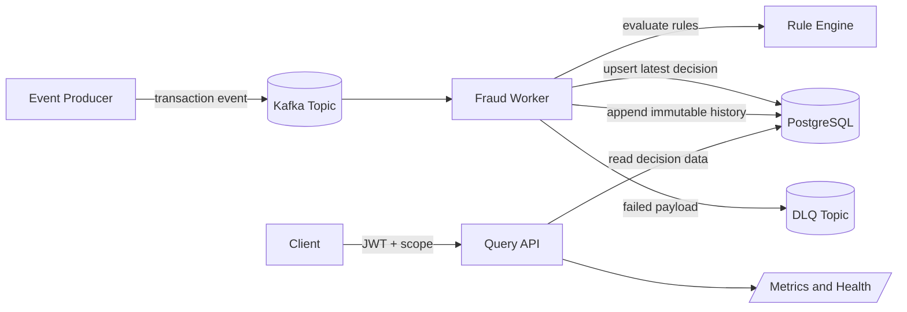

# Fraud Detection

Fraud Detection is an event-driven service that evaluates transaction events and stores fraud decisions for retrieval through a protected query API.

## Executive Summary

- Ingests transaction events from Kafka and evaluates deterministic fraud rules.
- Persists both latest decision state and immutable history in PostgreSQL.
- Exposes JWT-protected read APIs for transaction and category queries.
- Includes production-facing controls: rate limiting, structured logs, metrics, health probes, and DLQ routing.

## Repository Contents

- Query API built with FastAPI.
- Kafka worker that consumes transaction events and applies fraud rules.
- Scheduled batch worker for deferred jobs.
- PostgreSQL persistence and transaction history.
- Keycloak bootstrap helper for local auth setup.
- Helm chart for Kubernetes deployment.

## Architecture

### One-Page Diagram



### Processing model

1. Producers publish transaction events to Kafka.
2. Worker validates payloads, applies fraud rules, and stores outcomes.
3. Query API serves protected read endpoints from PostgreSQL.
4. Failed worker processing paths are routed to the DLQ.

## API Endpoints

Health and readiness:

- GET /live
- GET /ready
- GET /health

Protected data endpoints (require fraud:transactions:read scope):

- GET /api/v1/transactions/{transaction_id}
- GET /api/v1/categories/{category_name}?page=1&page_size=100

Optional token helper endpoints (enabled via AUTH_TOKEN_ENDPOINT_ENABLED):

- POST /api/v1/auth/token
- POST /api/v1/auth/service-token

## Fraud Rules

Default rules are defined in [rules.json](rules.json) and support:

- HIGH_VALUE_THRESHOLD
- RISKY_CATEGORY_LIMIT
- VELOCITY_COUNT_EXCEEDED
- VELOCITY_AMOUNT

The worker reloads rule configuration when the file changes.

## Design Decisions And Tradeoffs

1. Asynchronous fraud evaluation via Kafka

Benefit: Decouples ingest pressure from query latency.
Tradeoff: Introduces eventual consistency between ingestion and read visibility.

2. Deterministic rules first

Benefit: Preserves explainability through stable trigger labels.
Tradeoff: Is less adaptive than model-based approaches for unknown fraud patterns.

3. Shared transactional store for latest and history

Benefit: Keeps the operational model simple with a clear audit path.
Tradeoff: Read and write workloads share the same backing datastore.

4. Built-in operational safety controls

Benefit: Improves production diagnostics and failure handling.
Tradeoff: Increases setup complexity for local and environment configuration.

## Local Development

For the most reproducible first run on a fresh machine, start from a clean compose state:

```bash
docker compose --env-file .demo.env down -v --remove-orphans || true
```

1. Create and activate a virtual environment.
2. Install dependencies from [requirements.txt](requirements.txt).
3. Create a local compose environment file.
4. Start local infrastructure and app containers.

```bash
python3 -m venv .venv
source .venv/bin/activate
python -m pip install --upgrade pip
python -m pip install -r requirements.txt
cp .env.example .demo.env
docker compose --env-file .demo.env up --build
```

After startup, verify the stack:

```bash
docker compose --env-file .demo.env ps
curl -s http://localhost:8000/health
```

Local services from [docker-compose.yml](docker-compose.yml):

- API on http://localhost:8000
- Kafka UI on http://localhost:8080
- Keycloak on http://localhost:8081
- Kafka broker on localhost:9092

### Docker Compose Troubleshooting

If `docker compose up` fails with missing environment variable warnings, use an explicit env file:

```bash
docker compose --env-file .demo.env up --build
```

This repository may contain a `.env` directory on some machines, which prevents Compose from auto-loading dotenv values from a `.env` file path.

If token exchange returns invalid_client or 502 from `/api/v1/auth/token`, reset stale Keycloak/Postgres state and rerun:

```bash
docker compose --env-file .demo.env down -v --remove-orphans
docker compose --env-file .demo.env up --build
```

## Local Smoke Test Flow

1. Publish a transaction event to Kafka.
2. Pull the API for the transaction decision.

Quick publish helper:

```bash
chmod +x scripts/publish-transaction.sh
./scripts/publish-transaction.sh --transaction-id demo-123
```

Rule-trigger scenario publishers:

```bash
chmod +x scripts/publish-rule-*.sh

# Rule: HIGH_VALUE_THRESHOLD
./scripts/publish-rule-high-value.sh

# Rule: RISKY_CATEGORY_LIMIT
./scripts/publish-rule-risky-category.sh

# Rule: VELOCITY_COUNT_EXCEEDED
./scripts/publish-rule-velocity-count.sh

# Rule: VELOCITY_AMOUNT
./scripts/publish-rule-velocity-amount.sh
```

Verify a published transaction through the query API:

```bash
TOKEN=$(curl -s -X POST http://localhost:8000/api/v1/auth/token \
    -H "Content-Type: application/json" \
    -d '{"username":"demo","password":"demo"}' \
    | python3 -c "import sys,json; print(json.load(sys.stdin)['access_token'])")

curl -s -H "Authorization: Bearer $TOKEN" \
    "http://localhost:8000/api/v1/transactions/<TRANSACTION_ID>"
```

Use [integration_test.py](integration_test.py) to run this flow end-to-end. It publishes to Kafka and verifies retrieval via the API.

## Testing

Run tests:

```bash
/ usr/local/bin/python3 -m pytest tests -q --disable-warnings
```

Run tests with coverage:

```bash
/ usr/local/bin/python3 -m pytest tests -q --disable-warnings --cov=app --cov-report=term-missing
```

## Configuration

Use [.env.example](.env.example) as the baseline for local settings.

Important runtime variables include:

- DATABASE_URL
- KAFKA_BOOTSTRAP_SERVERS
- KAFKA_TOPIC_NAME
- KAFKA_DLQ_TOPIC_NAME
- KAFKA_CONSUMER_GROUP_ID
- JWT_ISSUER
- JWT_AUDIENCE
- FRAUD_RULES_CONFIG_PATH

Security and Kafka TLS settings are coveredter runbook details are in infra/README.md.