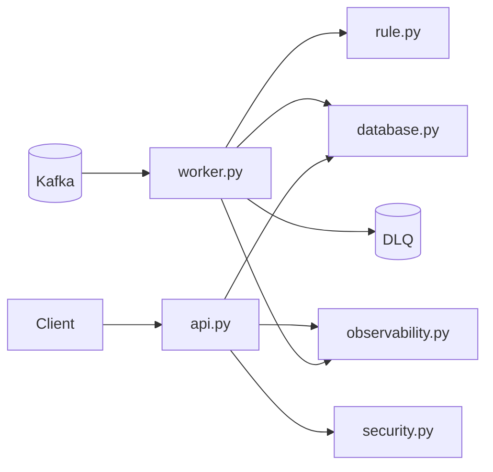

# Application package

## Executive Summary

The app package implements the runtime behavior of Fraud Detection: a JWT-protected query API, a Kafka-driven fraud worker, and a scheduled batch worker, backed by PostgreSQL and shared observability/security utilities.

## Runtime architecture

## Runtime Entrypoints

- [main.py](main.py): application entrypoint exporting app.
- [api.py](api.py): FastAPI creation, middleware wiring, endpoint definitions.
- [worker.py](worker.py): Kafka consume loop, fraud decisioning, persistence, DLQ routing.
- [batch_worker.py](batch_worker.py): scheduled workload for deferred processing.

## Module Map

- [settings.py](settings.py): env loading and runtime configuration validation.
- [database.py](database.py): async SQLAlchemy engine/session and transaction persistence helpers.
- [rule.py](rule.py): fraud rule evaluation and trigger generation.
- [security.py](security.py): JWT validation and principal extraction.
- [observability.py](observability.py): structured logging, metrics, trace hooks, IDs.
- [kafka_security.py](kafka_security.py): Kafka security protocol and TLS/OAuth options.
- [dlq.py](dlq.py): dead-letter payload shaping and encoding.

## API Surface

Health endpoints:

- GET /live
- GET /ready
- GET /health

Protected query endpoints:

- GET /api/v1/transactions/{transaction_id}
- GET /api/v1/categories/{category_name}

Optional token helper endpoints:

- POST /api/v1/auth/token
- POST /api/v1/auth/service-token

## Design Decisions And Tradeoffs

### 1. Shared persistence for worker and API
Benefit: Keeps the data model simpler and more auditable.
Tradeoff: Read and write paths contend on the same database.

### 2. At-least-once worker semantics
Benefit: Improves durability and replay safety.
Tradeoff: Requires idempotency discipline in persistence logic.

### 3. Explicit security and observability modules
Benefit: Keeps cross-cutting concerns centralized and testable.
Tradeoff: Onboarding requires understanding a few infrastructure-focused helpers.

## Contributor Guidance

- Keep trigger labels stable and explainable.
- Preserve worker safety around commit ordering and DLQ behavior.
- Keep metrics labels bounded and avoid sensitive data in labels.
