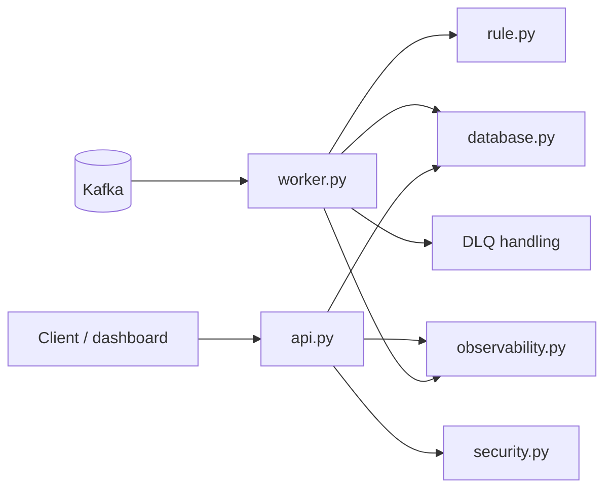

# Application package

This package contains the runtime implementation for the Fraud Detection service: the FastAPI query layer, Kafka consumer worker, batch worker, and the supporting configuration, security, rule, and observability modules.

## Runtime architecture

## Runtime entrypoints

- [main.py](main.py) — application entrypoint that exports the FastAPI app.
- [api.py](api.py) — API creation, dependency wiring, middleware, and route registration.
- [worker.py](worker.py) — Kafka consumer loop and fraud decision processing.
- [batch_worker.py](batch_worker.py) — scheduled batch processing.

## Key modules

- [config.py](config.py) — configuration helpers for the app runtime.
- [settings.py](settings.py) — environment-driven settings and validation.
- [database.py](database.py) — PostgreSQL session management and persistence helpers.
- [rule.py](rule.py) — rule evaluation and trigger generation.
- [security.py](security.py) — JWT validation and principal extraction.
- [observability.py](observability.py) — structured logging, metrics, tracing, and correlation IDs.
- [rate_limit.py](rate_limit.py) — request throttling middleware.
- [kafka_security.py](kafka_security.py) — Kafka security/TLS-related helpers.
- [dlq.py](dlq.py) — dead-letter payload shaping and recovery support.
- [token_service.py](token_service.py) — token helper logic for local auth workflows.
- [keycloak_bootstrap.py](keycloak_bootstrap.py) — bootstrap script for local Keycloak realm and demo user setup.

## API surface

Health endpoints:

- GET /live
- GET /ready
- GET /health

Protected query endpoints:

- GET /api/v1/transactions/{transaction_id}
- GET /api/v1/categories/{category_name}
- GET /api/v1/user/{user_id}

Rule evaluation endpoint:

- POST /api/v1/rules/{rule_key}/evaluate

## Design notes

### Shared persistence for API and worker

The API and worker both read and write through the same PostgreSQL-backed model, which simplifies auditing and keeps the latest decision state aligned with the full transaction history.

### At-least-once processing

The worker processes events with at-least-once semantics. That improves durability, but application logic must remain idempotent-safe around writes and any retry behavior.

### Security and observability are first-class modules

Cross-cutting concerns such as JWT validation, rate limiting, tracing, and logging are centralized so they remain consistent across the API and worker.

## Contributor guidance

- Keep trigger labels stable and human-readable.
- Preserve worker safety around commit ordering and DLQ behavior.
- Keep metrics labels bounded and avoid leaking sensitive information.
- Prefer config-driven behavior over hard-coded values for local and production runtime differences.
