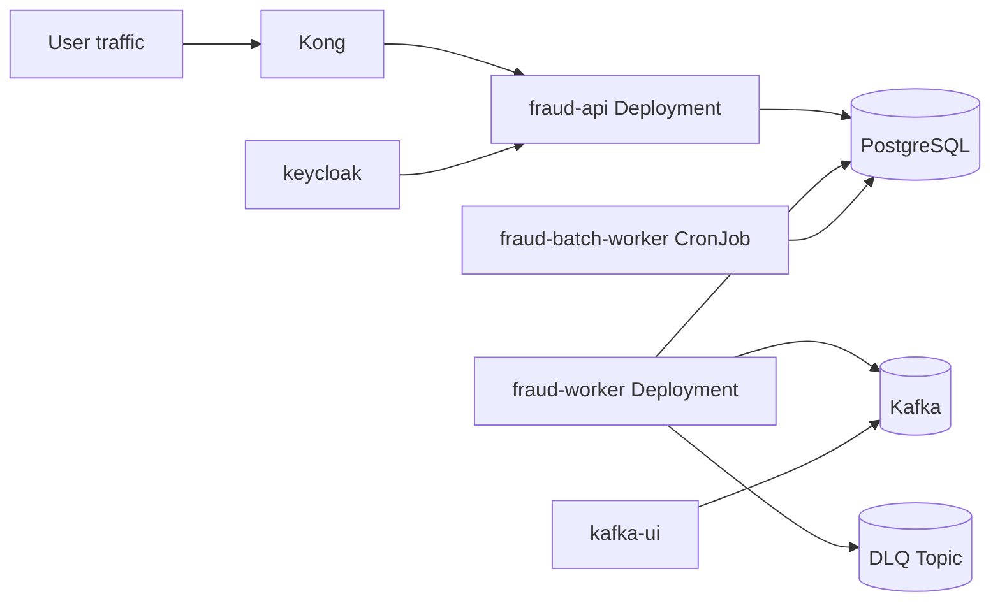

# Fraud Detection Helm Chart

## Executive Summary

This chart deploys the application runtime and supporting platform components for Fraud Detection,
with environment overlays for development and production.

## Deployment topology



## What The Chart Deploys

Application workloads:

- fraud-api Deployment and api Service
- fraud-worker Deployment
- fraud-batch-worker CronJob when batch.enabled is true

Supporting infrastructure:

- postgres Deployment and Service
- kafka Deployment and Service
- kong Deployment and Service with optional Ingress
- keycloak Deployment and Service
- kafka-ui Deployment and Service

Operational resources:

- fraud-configs ConfigMap
- alert rules and optional Alertmanager resources
- resilience resources such as PDBs and optional HPAs
- network policies

## Key Files

- Chart.yaml
- values.yaml
- values-dev.yaml
- values-prod.yaml
- templates/apps.yaml
- templates/infrastructure.yaml
- templates/gateways-ui.yaml
- templates/resilience.yaml

## Key Values To Tune

Workload images and scale:

- api.image.repository
- api.image.tag
- api.replicaCount

- worker.image.repository
- worker.image.tag
- worker.replicaCount

Batch scheduling:

- batch.enabled
- batch.runHour
- batch.runMinute
- batch.suspend

Security and auth:

- security.jwtIssuer
- security.jwtAudience
- security.jwtJwksUrl
- security.requiredReadScope
- security.authTokenEndpointEnabled

Application config:

- appConfig.kafkaTopicName
- appConfig.kafkaDlqTopicName
- appConfig.kafkaConsumerGroupId
- appConfig.defaultHighValueThreshold
- appConfig.defaultRestrictedCategoriesJson

Observability and persistence:

- observability.logLevel
- observability.enableTracing
- observability.workerMetricsPort
- persistence.postgres.*
- persistence.kafka.*

## Secrets

The chart expects an existing secret named by secrets.existingSecretName.

Required keys:

- postgres-password
- keycloak-token-client-secret
- keycloak-service-client-secret
- keycloak-demo-password

## Deployment Workflow

Development overlay:

```bash
helm upgrade --install fraud-system ./fraud-detection \
  -f ./fraud-detection/values.yaml \
  -f ./fraud-detection/values-dev.yaml \
  --namespace fraud-detection \
  --create-namespace
```

Production overlay:

```bash
helm upgrade --install fraud-system ./fraud-detection \
  -f ./fraud-detection/values.yaml \
  -f ./fraud-detection/values-prod.yaml \
  --namespace fraud-detection \
  --create-namespace
```

Validation:

```bash
kubectl -n fraud-detection get deploy
kubectl -n fraud-detection get cronjob
kubectl -n fraud-detection get svc
kubectl -n fraud-detection rollout status deploy/fraud-api
kubectl -n fraud-detection rollout status deploy/fraud-worker
```

## Design Decisions And Tradeoffs

### 1. Single chart for app and support components

Benefit: Improves local parity and simplifies onboarding.

Tradeoff: Platform and app lifecycles are coupled unless split later.

### 2. Values overlay model for environment differences

Benefit: Supports a predictable promotion path from dev to prod.

Tradeoff: Requires careful drift management across overlay files.

### 3. Embedded operational resources

Benefit: Enables repeatable deploys with alerts and resilience as code.
Tradeoff: Chart complexity is higher than a minimal runtime-only deployment.