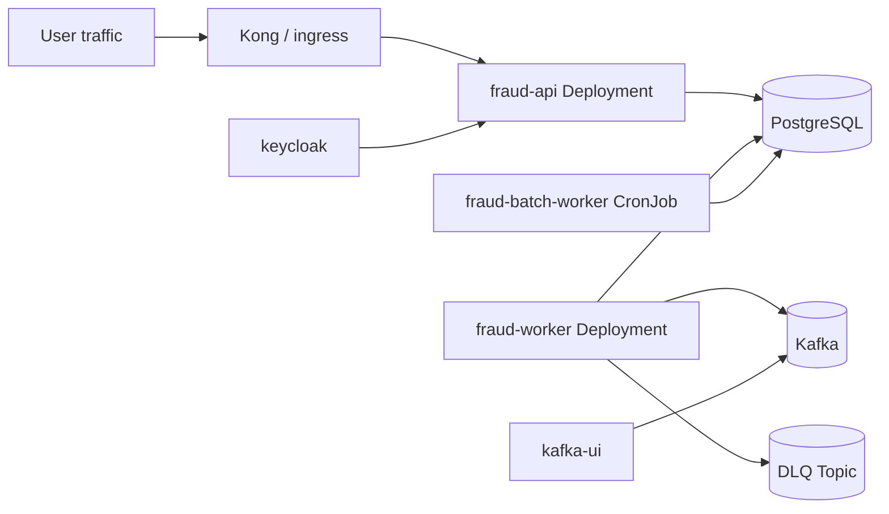

# Fraud Detection Helm chart

## Overview

This chart packages the Fraud Detection service and its supporting platform dependencies into a single Kubernetes deployment model. It is designed for environment overlays that keep the base deployment configuration stable while allowing dev and prod settings to diverge intentionally.

## Deployment topology



## What the chart deploys

Application workloads:

- `fraud-api` deployment and service
- `fraud-worker` deployment
- `fraud-batch-worker` CronJob when enabled

Supporting infrastructure:

- PostgreSQL
- Redis
- Kafka
- Keycloak
- Kafka UI
- Kong ingress / gateway layer

Operational resources:

- ConfigMap values for runtime configuration
- Secret-oriented configuration keys for credentials and external dependencies
- Resilience and networking resources such as PodDisruptionBudgets and optional scaling settings

## Key files

- `Chart.yaml`
- `values.yaml`
- `values-dev.yaml`
- `values-prod.yaml`
- `templates/apps.yaml`
- `templates/infrastructure.yaml`
- `templates/gateways-ui.yaml`
- `templates/resilience.yaml`

## Deployment workflow

Development overlay:

```bash
helm upgrade --install fraud-system ./fraud-detection \
  -f ./fraud-detection/values.yaml \
  -f ./fraud-detection/values-dev.yaml \
  --namespace fraud-detection \
  --create-namespace
```

Production overlay:

```bash
helm upgrade --install fraud-system ./fraud-detection \
  -f ./fraud-detection/values.yaml \
  -f ./fraud-detection/values-prod.yaml \
  --namespace fraud-detection \
  --create-namespace
```

Validation:

```bash
kubectl -n fraud-detection get deploy
kubectl -n fraud-detection get cronjob
kubectl -n fraud-detection get svc
kubectl -n fraud-detection rollout status deploy/fraud-api
kubectl -n fraud-detection rollout status deploy/fraud-worker
```

## Design decisions

### 1. Single chart for app and platform components

This keeps local parity high and simplifies onboarding, while making it easier to reason about the full runtime stack in one deployment artifact.

### 2. Values overlays for environment differences

The base chart is shared and environment-specific behavior is injected through `values-dev.yaml` and `values-prod.yaml`.

### 3. Operational resources embedded in the chart

Alerts, resilience, config, and secret wiring are represented as infrastructure as code so deployments are more repeatable and easier to validate.

## Related docs

- [../README.md](../README.md) — project overview and local development workflow
- [../infra/README.md](../infra/README.md) — runbook and deployment guidance
